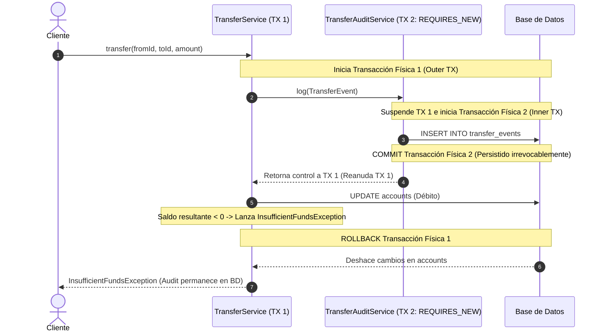

# Decisiones Arquitectónicas y Estrategia Transaccional (Week 10)

> **Módulo:** Gestión de Transacciones Empresariales con Spring & JPA / Hibernate  
> **Dominio:** Transferencias Bancarias y Auditoría Resiliente (Indra Bank)  
> **Nivel de Madurez:** Experto por Diseño  

---

## 🏛️ 1. Límites Transaccionales y Principio de Atomicidad

En el sector bancario, las operaciones de transferencia de fondos representan el caso de estudio clásico para el cumplimiento estricto de las propiedades **ACID** (Atomicidad, Consistencia, Aislamiento y Durabilidad):

* **Atomicidad (All-or-Nothing):** El débito sobre la cuenta de origen (`fromAccount`) y el crédito sobre la cuenta destino (`toAccount`) deben pertenecer a una **única unidad atómica de trabajo**. No se permite en ningún caso que el débito sea persistido si el crédito no se ejecuta exitosamente.
* **Consistencia:** El saldo total del sistema debe conservarse ($\Delta_{\text{origen}} + \Delta_{\text{destino}} = 0$) y ningún saldo puede violar la regla de invariante de negocio (fondos no negativos).
* **Aislamiento:** La lectura y modificación de las cuentas involucradas debe evitar lecturas sucias (*dirty reads*) o actualizaciones perdidas (*lost updates*).
* **Durabilidad:** Una vez completada la transferencia, el nuevo estado de las cuentas debe persistir irrevocablemente en almacenamiento no volátil.

### Delimitación de Capas: ¿Por qué `@Transactional` pertenece al Servicio?
* **Prohibido en Controladores REST / Capa Web:** Los controladores tienen la responsabilidad única de gestionar el protocolo HTTP (negociación de contenido, deserialización de DTOs, validación sintáctica `@Valid` y serialización de respuestas RFC 7807). Exponer transacciones a la capa web mantiene conexiones de base de datos abiertas durante el procesamiento de red, agotando el pool de conexiones (*Connection Pool Starvation*) y violando la Separación de Responsabilidades (SRP).
* **Prohibido en Repositorios:** Los repositorios de Spring Data JPA gestionan operaciones CRUD individuales. Métodos independientes como `save()` o `findById()` no tienen visibilidad de la orquestación del caso de uso.
* **Servicio de Aplicación como Orquestador:** `TransferService` es el límite transaccional adecuado donde se orquestan múltiples entidades (`Account`, `TransferEvent`) y servicios colaboradores.

---

## ⚠️ 2. Reglas de Rollback: Checked vs Unchecked Exceptions

Un fallo crítico común en arquitecturas corporativas radica en asumir que `@Transactional` revierte ante cualquier excepción lanzada.

### Comportamiento por Defecto en Spring Framework
El interceptor transaccional de Spring (`TransactionAspectSupport`) evalúa por defecto las excepciones según la siguiente regla:
* **Unchecked Exceptions (`RuntimeException` y `Error`):** Provocan `rollback-only`.
* **Checked Exceptions (`Exception` y derivadas directas no-runtime):** Provocan `commit`.

En este dominio:
```java
public class InsufficientFundsException extends Exception { ... }
```
`InsufficientFundsException` es una **Checked Exception**. Si el método se anota simplemente con `@Transactional`, cuando se lance la excepción tras haber ejecutado `fromAccount.setBalance(negativo)` y `saveAndFlush()`, **Spring procederá a confirmar la transacción en la base de datos**, dejando la cuenta origen con saldo negativo y en estado inconsistente.

### Mitigación Rigurosa
Se define explícitamente la directiva de reversión:
```java
@Transactional(rollbackFor = InsufficientFundsException.class)
public void transfer(Long fromAccountId, Long toAccountId, BigDecimal amount) 
        throws InsufficientFundsException { ... }
```
Esto garantiza que la infraestructura de proxies AOP intercepte la checked exception y emita la instrucción `ROLLBACK` al gestor transaccional (`PlatformTransactionManager` / `JpaTransactionManager`).

---

## 🔍 3. Análisis Comparativo: `Propagation.REQUIRES_NEW` vs `Propagation.NESTED`

El requisito de negocio exige que **el evento de auditoría de la transferencia sobreviva incluso si la transferencia falla y hace rollback**.



### Tabla Comparativa de Mecanismos de Propagación

| Dimensión de Análisis | `Propagation.REQUIRES_NEW` | `Propagation.NESTED` |
|---|---|---|
| **Canal de Conexión Física** | Abre una **segunda conexión física de BD independiente**, suspendiendo la actual. | Utiliza la **misma conexión y transacción física**, creando un `Savepoint` JDBC. |
| **Comportamiento si Falla la TX Externa (Outer)** | **El log sobrevive:** La TX interna ya fue confirmada (`COMMIT`) de manera autónoma antes del fallo externo. | **El log se destruye:** El `ROLLBACK` de la transacción externa anula y destruye toda la transacción física incluyendo todos sus savepoints. |
| **Comportamiento si Falla la TX Interna (Inner)** | Puede ser capturada con `try/catch` sin forzar rollback de la transacción externa, o propagarse. | Permite hacer rollback local al savepoint sin abortar la transacción externa. |
| **Soporte en JPA / Hibernate** | **Nativo y 100% portable** sobre cualquier proveedor JPA (`JpaTransactionManager`). | **No soportado de forma estándar** por JPA; requiere acceso JDBC nativo y dialectos específicos. |
| **Caso de Uso Idóneo** | Auditoría obligatoria, facturación independiente, telemetría, contadores globales. | Operaciones secundarias opcionales que pueden fallar sin arruinar la transacción principal. |

> **Conclusión Experta:** Para asegurar que el log de auditoría sobreviva al rollback de la transferencia, `REQUIRES_NEW` es la **única alternativa arquitectónicamente correcta y funcional**. El uso de `NESTED` provocaría la pérdida total de la auditoría en cada intento de fraude o fallo por saldo insuficiente.

---

## 🛡️ 4. Aislamiento y Prevención de Anti-patrones AOP

### Eliminación de Auto-Invocación (Self-Invocation)
En Spring, la anotación `@Transactional` opera mediante **Proxies Dinámicos (Spring AOP)**. Si una clase contiene dos métodos transaccionales y uno invoca internamente al otro (`this.log(event)`):
* La invocación se realiza directamente sobre la instancia subyacente (`this`), evitando el proxy de Spring.
* **Consecuencia:** La propagación (`REQUIRES_NEW`) es completamente ignorada y el método se ejecuta silenciosamente dentro de la transacción original.

Para prevenir esta vulnerabilidad estructural, `TransferAuditService` está modelado como un componente independiente (`@Service`), e inyectado vía constructor dentro de `TransferService`. De este modo, la llamada atraviesa formalmente la capa de intercepción AOP.
