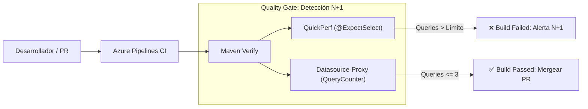

# Estrategia de Optimización de Rendimiento ORM y Erradicación de N+1 (Week 11)

> **Módulo:** Optimización de Consultas JPA / Hibernate y Performance de Base de Datos  
> **Dominio:** Sistema de Gestión de Órdenes e Ítems (Indra Retail)  
> **Nivel de Madurez:** Experto por Diseño  

---

## 📊 1. Diagnóstico del Problema N+1 y Medición Cuantitativa

En arquitecturas empresariales basadas en JPA y Hibernate, el problema de las **$N+1$ consultas** es una de las principales fuentes de degradación de latencia, contención de conexiones y saturación de memoria.

### Análisis del Escenario Inicial (Baseline sin Optimización)
En `week-11-start`, la entidad `Order` mapea su colección de `items` con `FetchType.LAZY`, y cada `OrderItem` mapea su relación `product` con `FetchType.LAZY`:
```java
// Order.java
@OneToMany(mappedBy = "order", cascade = CascadeType.ALL, orphanRemoval = true)
private List<OrderItem> items = new ArrayList<>();

// OrderItem.java
@ManyToOne(fetch = FetchType.LAZY, optional = false)
@JoinColumn(name = "product_id")
private Product product;
```

Cuando el servicio `OrderService.listByStatus()` recorre la lista de órdenes para transformarlas a DTOs (`OrderView`):
$$\text{Total Queries} = 1 + N_{\text{órdenes}} + (N_{\text{órdenes}} \times \text{ítems por orden})$$

Para el dataset de prueba de **$50$ órdenes** con **$3$ ítems por orden**:
* **1 query** inicial para obtener las 50 órdenes: `select o.id, o.customer_name, ... from orders o where o.status=?`
* **50 queries** individuales para cargar los ítems de cada orden: `select ... from order_items where order_id=?`
* **150 queries** individuales para cargar el producto de cada ítem: `select ... from products where id=?`
* **Total ejecutado reportado:** **`201 queries SQL`** (para 100 órdenes serían 401 queries).

### Resultados Posteriores a la Optimización
| Métrica | Antes (Baseline) | Con `JOIN FETCH` / `@EntityGraph` | Reducción (%) |
|---|:---:|:---:|:---:|
| **Listado Completo (50 órdenes)** | **201 queries** | **1 query SQL** | **-99.5%** |
| **Listado Paginado (Page de 20)** | **81 queries** | **2 queries SQL** (1 count + 1 data) | **-97.5%** |
| **Latencia estimada de red (a 5ms/RTT)** | $\approx 1005\text{ ms}$ | $\approx 5\text{ ms}$ | **-99.5%** |

---

## 🛠️ 2. Estrategia 1: `JOIN FETCH` en JPQL

La solución fundamental consiste en instruir al motor de Hibernate para que obtenga todo el grafo de objetos necesario en una única sentencia SQL compuesta mediante `JOIN FETCH`:

```java
@Query("SELECT DISTINCT o FROM Order o JOIN FETCH o.items i JOIN FETCH i.product WHERE o.status = :status")
List<Order> findByStatus(@Param("status") OrderStatus status);
```

### Principios Clave:
1. **Uso de `DISTINCT`:** Al realizar un producto relacional entre `orders` y `order_items`, el motor de base de datos retorna múltiples filas por cada orden (una fila por cada ítem). La palabra clave `DISTINCT` en JPQL garantiza que Hibernate construya una única instancia de `Order` en el *Persistence Context* con su lista interna de ítems poblada, sin duplicar referencias en la lista resultante.
2. **Prohibición de `FetchType.EAGER`:** Configurar `@OneToMany(fetch = FetchType.EAGER)` en la entidad es un anti-patrón severo:
   * Aplica la carga ansiosa a **todos los casos de uso** del sistema (incluso cuando solo se necesita el ID o el cliente de la orden).
   * Genera el problema de multiplicación cartesiana (`MultipleBagFetchException`) si coexisten múltiples colecciones.
   * `FetchType.LAZY` se mantiene en el 100% de las entidades del dominio; la avidez de carga se define exclusivamente a nivel de consulta según las necesidades específicas del caso de uso.

---

## 🌐 3. Estrategia 2: `@EntityGraph` (Bonus Cumplido)

Para consultas paginadas con `Pageable`, el uso de `JOIN FETCH` directo en colecciones presenta advertencias de Hibernate (`HHH000104: firstResult/maxResults specified with collection fetch; applying in memory`), ya que no es posible aplicar `LIMIT` y `OFFSET` directamente sobre un join que multiplica las filas sin truncar ítems de una orden.

Para resolver este desafío de manera limpia y sin advertencias, se implementó `@EntityGraph`:

```java
@EntityGraph(attributePaths = {"items", "items.product"})
Page<Order> findByStatus(OrderStatus status, Pageable pageable);
```

### Ventajas de `@EntityGraph`:
* **Separación de Conteo y Datos:** Spring Data JPA ejecuta automáticamente la consulta de conteo (`SELECT COUNT(o.id) FROM Order o WHERE o.status = ?`) sin hacer join a las colecciones secundarias.
* **Carga por Grafo Ad-Hoc:** Hibernate utiliza `LEFT OUTER JOIN` dinámicos respetando los límites de paginación de la base de datos.
* **Total Queries:** Exactamente **2 queries** (1 conteo + 1 lote de datos), cumpliendo el SLA de $\le 3$ queries para paginación.

---

## 📦 4. Estrategia 3: `hibernate.default_batch_fetch_size` (Bonus Cumplido)

En `application-dev.properties` se configuró el tamaño de procesamiento por lotes para cargas diferidas:

```properties
hibernate.default_batch_fetch_size=25
```

### Impacto Operativo:
Si por alguna regla de negocio imprevista se accede a una asociación LAZY que no fue precargada con `JOIN FETCH`, Hibernate no ejecutará consultas unitarias ($N$). En su lugar, acumulará los identificadores pendientes y ejecutará consultas agrupadas:
```sql
SELECT ... FROM order_items WHERE order_id IN (?, ?, ?, ..., ?)
```
Para 50 órdenes, el número de consultas secundarias pasa de **50 queries individuales** a únicamente **$\lceil 50 / 25 \rceil = 2$ queries**, sirviendo como una red de seguridad (*safety net*) indispensable contra el N+1 inadvertido en producción.

---

## 🚀 5. Diferenciación Experto: Estrategia de Detección de N+1 en CI/CD

El nivel Experto no se limita a corregir el N+1 actual, sino que diseña la arquitectura para **prevenir que regresiones de N+1 vuelvan a entrar al repositorio**.

### Propuesta de Arquitectura de Calidad Automatizada:



1. **Framework QuickPerf en Tests Unitarios / Slice Tests:**
   * Anotar los tests de integración con `@ExpectSelect(max = 3)` o `@DisableSameSelectTypesWithDifferentParamValues`.
   * Si un cambio en el servicio o controlador introduce una iteración perezosa, QuickPerf falla el test inmediatamente en la máquina del desarrollador y en el pipeline de Azure DevOps.
2. **Datasource-Proxy (`net.ttddyy:datasource-proxy`):**
   * Envolver el pool de HikariCP en entornos de prueba con un proxy transparente.
   * Proporciona métricas exactas del número de `Statement`, `PreparedStatement` y `BatchSize` ejecutados por endpoint REST.
3. **Hibernate Statistics Assertion en CI (`QueryCounter`):**
   * El componente `QueryCounter` implementado en `OrderQueryCountTest` se integra en las suites de prueba de regresión para certificar formalmente que las consultas críticas no excedan los umbrales de SLA.
